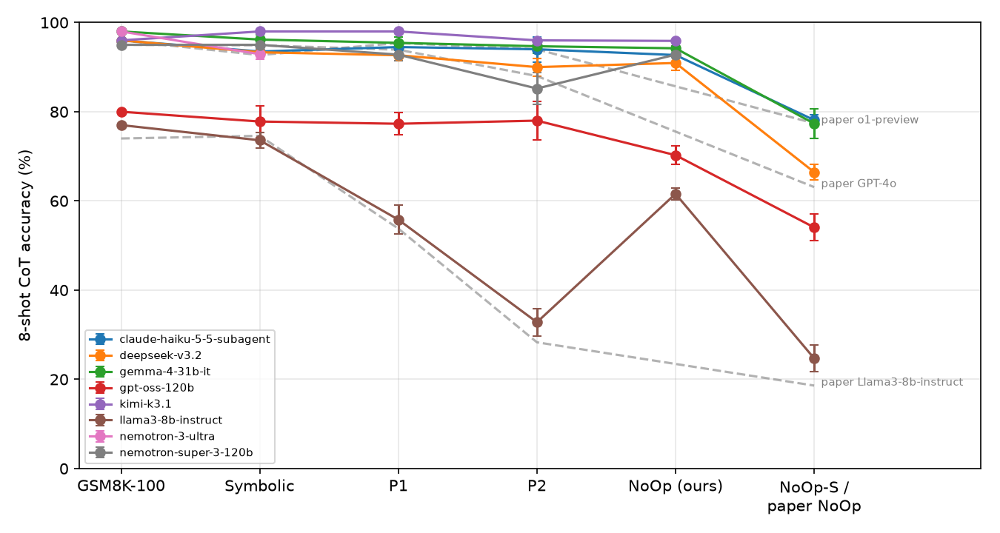

# GSM-Symbolic on 2026 models

A re-run of **GSM-Symbolic** (Mirzadeh et al., *Understanding the Limitations of Mathematical Reasoning in
Large Language Models*, ICLR 2025, [arXiv 2410.05229](https://arxiv.org/abs/2410.05229)) on models released
in 2025 and 2026, with the paper's prompt, shots, decoding and answer parser, a reproduction check on a
model the paper tested, a pre-registered hypothesis, and a rebuttal.

| Document | Contents |
|---|---|
| [PREREGISTRATION.md](PREREGISTRATION.md) | Hypotheses H1 to H3 and their thresholds, committed before scoring |
| [results/TABLES.md](results/TABLES.md) | Every table, rebuilt from the raw logs by `python -m gsmsym.score` |
| [REBUTTAL.md](REBUTTAL.md) | Which claims hold on 2026 models, which do not, and where the method is weak |
| [RELATED_WORK.md](RELATED_WORK.md) | Replications, critiques and follow-ups, each opened and checked |

## Headline results

8-shot CoT accuracy (%), mean over instance sets [sets]. Full tables with SDs, drops and 95% CIs:
[results/TABLES.md](results/TABLES.md).

| Model (released) | Mode | GSM8K-100 | Symbolic | P1 | P2 | NoOp (ours) | NoOp-S |
|---|---|---|---|---|---|---|---|
| *Paper: GPT-4o* | API | 95.0 | 94.9 | 93.9 | 88.0 | 63.1 (Apple's) | |
| *Paper: o1-preview* | API | 96.0 | 92.7 | 95.4 | 94.0 | 77.4 (Apple's) | |
| *Paper: Llama-3-8B-Instruct* | API | 74.0 | 74.6 | 53.8 | 28.3 | 18.6 (Apple's) | |
| Llama-3-8B-Instruct (2024), our anchor | API | 77.0 | 73.6 [5] | 55.8 [5] | 32.8 [5] | 61.6 [5] | 24.7 [5] |
| Gemma 4 31B (2026) | API | 98.0 | 96.2 [50] | 95.4 [50] | 94.7 [50] | 94.2 [10] | 77.3 [10] |
| DeepSeek V3.2 (2026) | API | 96.0 | 93.3 [3] | 92.7 [3] | 90.0 [3] | 90.9 [3] | 66.5 [2] |
| Nemotron 3 Super 120B (2026) | API | 95.0 | 95.0 [5] | 92.8 [5] | 85.2 [5] | 92.8 [5] | – |
| Nemotron 3 Ultra (2026) | API | 98.0 | 92.9 [10] | – | – | – | – |
| Kimi K3.1 (2026-11) | API | 96.0 | 98.0 [1] | 98.0 [1] | 96.0 [1] | 95.9 [1] | – |
| GPT-OSS-120B (2025) | API | 80.0 | 77.8 [10] | 77.3 [10] | 78.0 [10] | 70.3 [10] | 54.1 [10] |
| Claude Haiku 5.5 (2026) | Claude Code subagent | 96.0 | 93.5 [2] | 94.5 [2] | 94.0 [2] | 92.7 [2] | 78.1 [2] |



- **Reproduction:** Llama-3-8B-Instruct matches the paper on Symbolic, P1 and P2 (within 2 paper SDs).
- **Symbolic, P1, P2:** 2026 models lose −2 to +5 points (P2 up to +9), against 20 to 45 for Llama-3-8B.
- **Variance:** every SD across sets, ours and the paper's, is at or below binomial sampling noise.
- **NoOp:** on our mild NoOp, 2026 drops are 0 to 8 points; on NoOp-S, which reproduces the paper's NoOp
  on Llama-3-8B (24.7 vs 18.6), 2026 models still lose 20 to 31 points, but only 0 to 5 on the clauses an
  auditor judged truly irrelevant. Llama-3-8B loses 53 points on those too.
- **Pre-registered H1** ("2026 models will do much better"): **partly supported**. See
  [REBUTTAL.md](REBUTTAL.md).
- GPT-OSS-120B's low scores are partly the paper's last-number parser: a format-aware parser adds 7 to 9
  points.


## Method

| Setting | Value |
|---|---|
| Data | Official release, [apple/ml-gsm-symbolic](https://github.com/apple/ml-gsm-symbolic) at `3b645c25`: Symbolic and P1 (100 templates × 50 instances), P2 (50 × 50) |
| Baseline | GSM8K-100: the 100 original GSM8K test questions behind the templates (paper Tab. 1, "GSM8K (100)") |
| NoOp | Not released by Apple. Our reconstruction (pre-registered) and NoOp-S, Sturgeon's 2026 set (exploratory), below |
| Prompt | The README template: header, the 8 common GSM8K CoT exemplars (lm-evaluation-harness `c0745fec`), `Q: … A: Let's think step by step.` |
| Decoding | temperature 0 where the API allows; Kimi K3/K3.1 reject the field and use defaults; reasoning models keep default reasoning |
| Parser | The paper's rule: cut at `\nQ:`, drop commas, take the last number, compare as float. A "final answer is" parser is reported as a check |
| Metrics | Mean accuracy over instance sets, SD across sets, drop from GSM8K-100 with a 95% paired bootstrap CI over templates |
| Instance sets | A set is instance *k* of every template. Sets per model and variant are listed in each table cell |

**NoOp reconstruction.** For every Symbolic instance, Gemma 4 31B writes one sentence that contains a
number, sounds relevant and leaves the answer unchanged (the recipe of the paper's Fig. 7). GPT-OSS-120B and
Nemotron 3 Ultra then judge independently whether the answer stays the same (all of sets 0 to 9 are judged and
run; sentences for sets 10 to 49 are generated, partly judged and not yet run). The sentence is inserted before
the item's final question sentence at run time. We report NoOp on all items and on items both judges call
UNCHANGED. Only our sentences are published (`noop/clauses.jsonl`); NoOp prompts are logged as hashes.
Our NoOp turned out much milder than Apple's (Llama-3-8B: 61.6% vs the paper's 18.6%), so we added
**NoOp-S**: the 945 clauses of Sturgeon (2026; Hugging Face `Experimental-Orange/gsm-noop-audited`, written
by Claude Opus 4.6, audited by GPT-5.5), which gives 24.7% on Llama-3-8B and so tracks Apple's set.
`scripts/fetch_data.sh` downloads it; we do not redistribute it.

**Reproduction anchor.** Llama-3-8B-Instruct, which the paper tested, runs through raw text completion on
Bedrock (no chat template), the closest match to the paper's open-model setup. A first attempt through the
chat API with a `Q:` stop sequence cut every answer short (31/100); it is kept in `runs/_discarded/`.

## Routes and deployment mode

Deployment mode is a variable here, not a detail.

| Mode | Route | Models |
|---|---|---|
| Raw API decoding, as in the paper | Amazon Bedrock (Converse or raw completion) | Llama-3-8B-Instruct, DeepSeek V3.2, Nemotron 3 Super 120B, Kimi K3.1 |
| Raw API decoding, as in the paper | ALCF inference service (OpenAI-compatible) | Gemma 4 31B, GPT-OSS-120B, Nemotron 3 Ultra (Symbolic only; slow) |
| Agent harness | Claude Code subagents | Claude Haiku 5.5 |

Claude models were run only as Claude Code subagents, never through a paid API. Each subagent gets 50
problems in one prompt (the 8 shots once, then each problem in the paper's format), answers by reasoning
only, and returns its text; batches where the subagent used any tool other than the final hand-off are
discarded (none were). Answers are then scored with the same parser. This is **not** comparable one-to-one
with API decoding: default sampling instead of greedy, the Claude Code system prompt, and 50 problems
sharing one context. These results are kept in a separate table.

The original paper decodes greedily from a bare prompt. That is one assumption about how models are used.
We found no public source giving the split between raw API use and app or agent-harness use; Anthropic's
Economic Index ([arXiv 2511.15080](https://arxiv.org/abs/2511.15080)) shows both channels are large but does
not give shares. So we report the modes side by side and do not claim either is "real" use.

**Not reached.** On Bedrock, Claude 4.7 to 5.5, GPT-5.4 to 6.1, Grok 4.6/4.7 and GLM-5.3 return
`AccessDeniedException` ("not available for this account"): access was never enabled for the account we
used, and enabling it means accepting new provider terms, which we did not do. Mistral Large 4 on ALCF
answered only in its reasoning channel and took about 80 s per item, so it was dropped.

## Cost

| Item | Amount |
|---|---|
| Bedrock cash spent (logged tokens × list price) | **$9.15** (pilot cap $10) |
| Of which Kimi K3.1 (reasoning, $3.30/$16.50 per M tokens) | $5.52 for 447 items |
| ALCF | $0 (existing allocation) |
| Claude Haiku 5.5 subagents | $0 cash; 20 batches, 984 problems, 3.1 M tokens (about 3,100 per problem, most of it the subagent's own context) plus about 0.5 M dispatcher tokens |

**Quote for the full protocol** (17,300 items per model; per-variant token use measured in our runs;
[results/COST.md](results/COST.md)):

| Model | Full-run USD |
|---|---|
| Llama-3-8B-Instruct | 9.17 |
| DeepSeek V3.2 | 20.01 |
| Nemotron 3 Super 120B | 6.64 |
| Kimi K3.1 | 227.91 |
| **All four** | **263.72** (254.57 beyond what is spent) |
| Without Kimi K3.1 | 35.81 |

The Kimi K3.1 line exceeds the $10/day agent cap by itself and needs approval. Claude Haiku 5.5 at full
scale would take about 352 subagent batches, roughly 54 M tokens of the shared Claude usage window plus
dispatch, so we stopped at the pilot. Gemma 4 31B already has all 50 sets of Symbolic, P1 and P2 on ALCF.


## Reproducing

```bash
./scripts/fetch_data.sh                          # official data at the pinned commit
export GSMSYM_AWS_CMD="aws"                      # or your audited wrapper; needs bedrock-runtime access
export GSMSYM_ALCF_TOKEN_CMD="python inference_auth_token.py get_access_token"
python -m gsmsym.run deepseek-v3.2 symbolic --instances 0-4 --budget-usd 1
python -m gsmsym.noop generate --instances 0-9 && python -m gsmsym.noop judge --instances 0-9
python -m gsmsym.score                           # rebuilds results/ and figures/ from runs/
```

Claude Code subagent batches: `python -m gsmsym.subagent make --variant p1 --instances 0-1`, give each
`batches/*.txt` verbatim to a subagent, then `python3 scripts/collect_subagents.py <transcript dir>` and
`python -m gsmsym.subagent ingest --model claude-haiku-5-5-subagent`.

### Run folders

Same layout as [LUC-AI4FM/ALIAS](https://github.com/LUC-AI4FM/ALIAS). `custom_id` is
`<template>-<condition>-<instance>`, the ALIAS `<spec_id>-<condition>-<sample>` convention.

| File | Contents |
|---|---|
| `runs/<model>/requests.jsonl` | model id, route, decoding settings, prompt (NoOp: SHA-256 only) |
| `runs/<model>/raw.jsonl` | unedited response text, stop reason, token usage, UTC date, latency, errors |
| `runs/<model>/graded.json` | per item: `id`, `condition`, `instance`/`sample`, `pred`, `gold`, `pass`, `pass_final_rule` |
| `runs/<model>/provenance.jsonl` | code and input hashes, git head, model, route, decoding, per invocation |
| `runs/claude-*-subagent/batches/` | each subagent's full returned text and its tool and token counts |

## For ALIAS

[LUC-AI4FM/ALIAS](https://github.com/LUC-AI4FM/ALIAS) asks what a renaming drop measures in TLA+. GSM-Symbolic
changes names *and* numbers in math word problems whose answer is a single number, so a name cannot leak
into the grade. That makes this repository a cross-domain control for ALIAS.

Reusable as is:

- `results/summary.json`: per model and variant, mean accuracy, SD across sets, drop from GSM8K-100 with
  95% paired bootstrap CI, binomial SD check, and parser sensitivity.
- `runs/<model>/graded.json`: per item `id`, `condition`, `sample`, `pass`, the same keys ALIAS's
  `behavior_graded.json` uses (`id` plays the role of `spec_id`).
- `runs/<model>/raw.jsonl` and `requests.jsonl`: same record fields as ALIAS (`custom_id`, `type`, `text`,
  `stop_reason`, `usage`), one JSONL file per run instead of one file per sample.
- `gsmsym/routes.py`: Bedrock and ALCF clients with transient-error retries and no credential logging.

The Symbolic condition (new names and new numbers, same template) is the closest analogue of ALIAS's
`renamed` condition; P1, P2 and NoOp have no ALIAS counterpart. Cite a commit, for example:

```bibtex
@misc{gsmsymbolic2026,
  title  = {GSM-Symbolic on 2026 models: reproduction, pre-registered test and rebuttal},
  author = {{LUC-AI4FM}}, year = {2026},
  howpublished = {\url{https://github.com/LUC-AI4FM/gsm-symbolic-2026}}, note = {commit <hash>}
}
```


## Model output terms

We publish model outputs for research. Checked: Google's Gemma terms (§3.3, Google claims no rights in
outputs), the Meta Llama 3 license (outputs may not be used to improve other LLMs, §1.b.v; we publish
them for evaluation only, with the attribution "Built with Meta Llama 3"), and Anthropic's Commercial Terms (customer owns outputs,
§B; no training of competing models, §D.4). Not reviewed clause by clause: DeepSeek (MIT model license),
Kimi (modified MIT), NVIDIA Nemotron (NVIDIA Open Model License), GPT-OSS (Apache 2.0); we found nothing in
these model cards restricting publication of outputs. **Do not use `runs/` to train models.**

## License

Code and our text: MIT ([LICENSE](LICENSE)). GSM-Symbolic data: CC BY-NC-ND 4.0, © Apple, not vendored;
request logs quote unmodified items with attribution. GSM8K: MIT.

## Citation

```bibtex
@misc{gsm-symbolic,
  title  = {GSM-Symbolic: Understanding the Limitations of Mathematical Reasoning in Large Language Models},
  author = {Iman Mirzadeh and Keivan Alizadeh and Hooman Shahrokhi and Oncel Tuzel and Samy Bengio and Mehrdad Farajtabar},
  year   = {2024}, url = {https://arxiv.org/abs/2410.05229}
}
```
